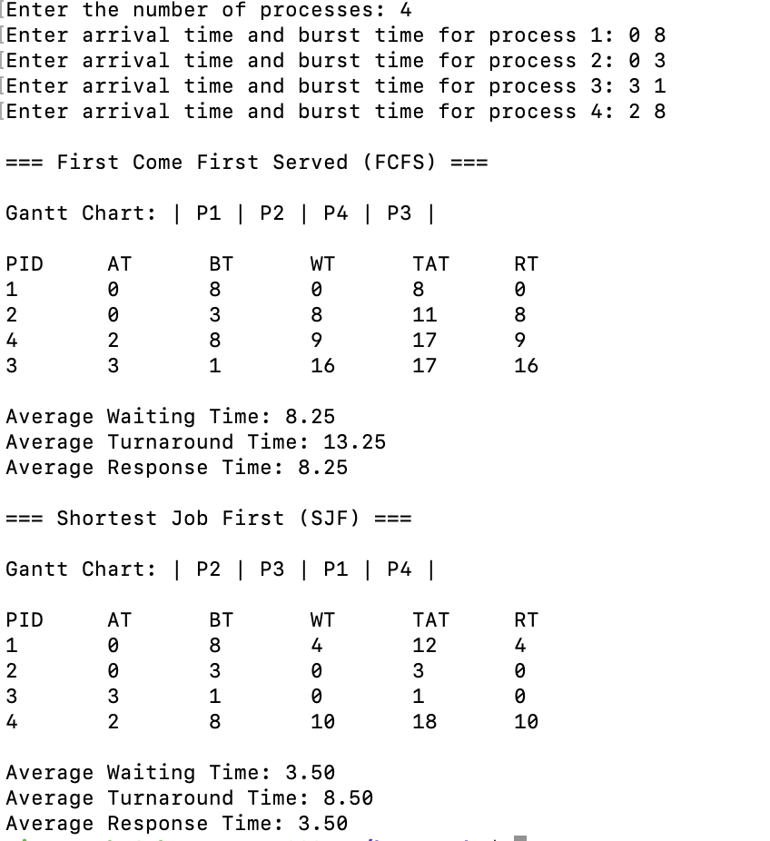

# CPU Scheduling Simulator

This program is written in C and simulates two non-preemptive CPU scheduling algorithms:

- First Come First Served (FCFS)
- Shortest Job First (SJF)

The user enters the number of processes and the arrival time and burst time of each process. The program displays the execution order in a Gantt chart and calculates waiting time (WT), turnaround time (TAT), and response time (RT) for each process. It also displays the average times for both algorithms.

## How to Run

On Linux, open a terminal in the folder containing `scheduling.c`.

Compile the program:

```bash
gcc scheduling.c -o scheduling
```

Run it:

```bash
./scheduling
```

## Example Input

```text
Enter the number of processes: 4
Enter arrival time and burst time for process 1: 0 8
Enter arrival time and burst time for process 2: 0 3
Enter arrival time and burst time for process 3: 3 1
Enter arrival time and burst time for process 4: 2 8
```

## How the Algorithms Work

**FCFS:** Processes run in order of arrival. If two processes arrive at the same time, the one entered first runs first.

**SJF:** Among the processes that have arrived, the one with the shortest burst time runs next. If burst times are equal, the earlier arrival is chosen. Once a process starts, it runs until it finishes.

## Time Calculations

- Turnaround time = Completion time - Arrival time
- Waiting time = Turnaround time - Burst time
- Response time = Waiting time (for these non-preemptive algorithms)

## Example Results

For the input above:

- FCFS order: P1 -> P2 -> P4 -> P3
  - Average WT: 8.25, average TAT: 13.25, average RT: 8.25
- SJF order: P2 -> P3 -> P1 -> P4
  - Average WT: 3.50, average TAT: 8.50, average RT: 3.50

## Screenshots

The screenshot below shows the program input and output for both algorithms.


